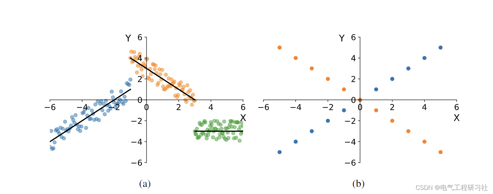
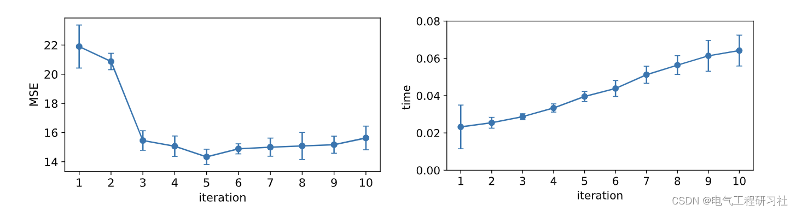
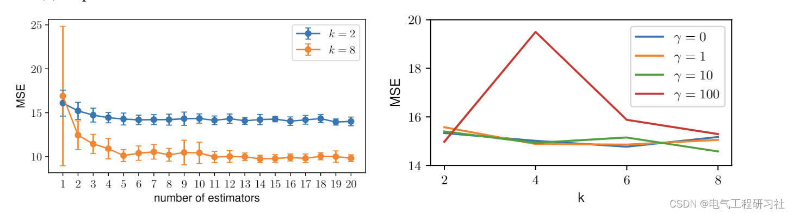
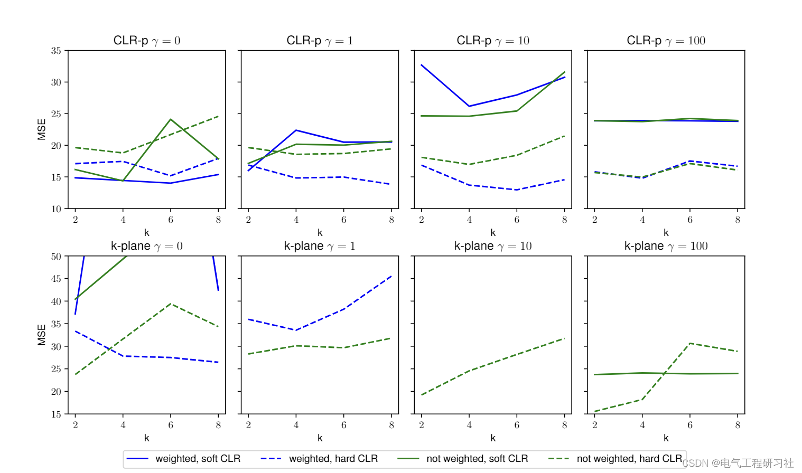
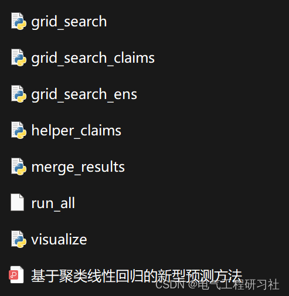

# New prediction method based on clustering linear regression (Python code implementation)

1. Overview
In this paper, we explore different regression models based on clustering linear regression (CLR). CLR aims to divide the data into k clusters so that the linear regression for each cluster minimizes the overall mean squared error of the entire data. The main obstacle preventing the use of the found regression model to predict invisible test points is the lack of a reasonable method to obtain CLR cluster labels when the target variable values are unknown. In this paper, we propose two new methods to solve this problem. The first method, prediction CLR, constructs a separate classification model to predict the test CLR labels. The second method, constrained CLR, uses a set of user-specified constraints to force certain points into the same cluster. Assuming the test point constraints are known, they can be directly used to assign CLR labels. We evaluate these two methods on three UCI ML datasets and a large health insurance claim corpus. We show that both proposed algorithms significantly improve over known CLR-based regression methods. Moreover, prediction CLR consistently outperforms linear regression and random forest, and shows comparable performance to vector regression on the UCI ML dataset. The constrained CLR method achieves the best performance on the health insurance dataset, with only about 20 times more computation time than linear regression.
2 Mathematical Model
Clustering Linear Regression (CLR) [21] is an effective technique for analyzing data assumed to be generated by linear regression models mixed together. Formally, given a dataset with n points and d features, CLR aims to divide the data into k non-overlapping clusters such that the sum of the squared errors of the linear regression models within each cluster is minimized:
The rest of the mathematical models and explanations are in Part Four.
3 Simulation Results
3.1 Simulation Setup
3.2 Simulation Results
4 Python Code and Article Reading
This paper only showcases part of the code, all codes are available in:
4.1 Python Code
4.2 Article Reading

## Images

<!-- PAYMENT_BLOCK -->

## Get this dataset

- Payment link (Stripe): [Buy now](https://buy.stripe.com/3cs8yP7sY87d0vu9AB)
- Payment QR code: 

<!-- /PAYMENT_BLOCK -->
